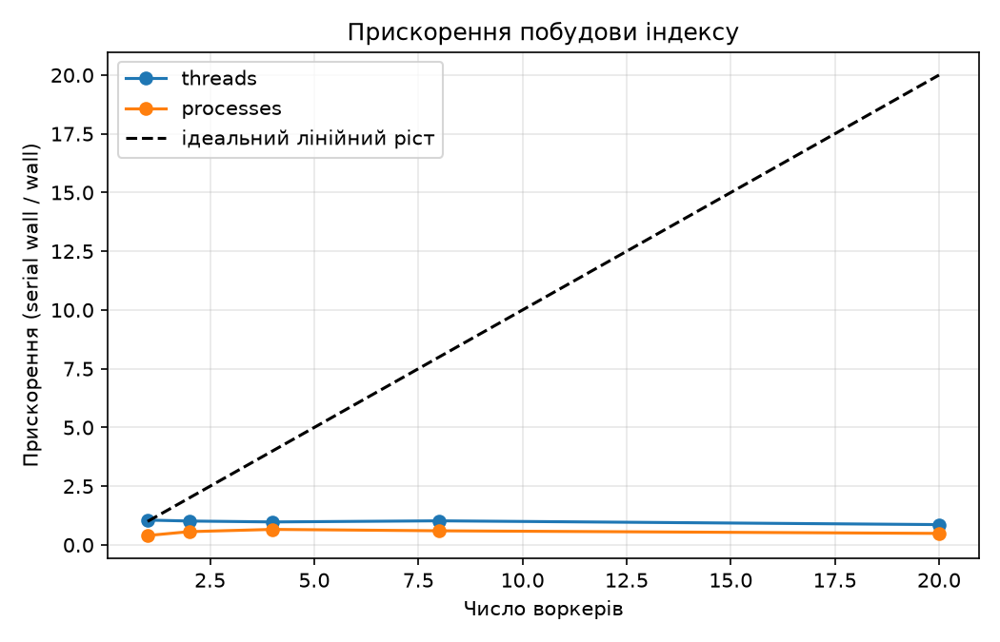

# findex


Пошуковий рушій за інвертованим індексом із підтримкою булевих запитів, фразового пошуку, ранжування (BM25, TF-IDF) та CLI-інтерфейсу.

## Встановлення

Проєкт налаштовано для встановлення однією командою через `uv`:

```bash
uv tool install .
```

Або зі зібраного `wheel`-пакета:

```bash
uv tool install findex-0.4.0-py3-none-any.whl
```

## Використання CLI

* **Побудова індексу з папки документів:**
  ```bash
  findex index data/ -o data/index.bin --positions
  ```
* **Ранжований пошук (вивід таблицею або у JSON):**
  ```bash
  findex search data/index.bin "python AND search"
  findex search data/index.bin "ангел" --json
  ```
* **Статистика індексу:**
  ```bash
  findex stats data/index.bin
  ```
* **Діагностичні логи (`stderr`):** прапорці `-v` (INFO) та `-vv` (DEBUG) перед підкомандою.

## Тестування та покриття коду

* Загальне покриття тестами (`pytest --cov=findex`): **98%** (130 тестів, включно з property-based
*  тестами на Hypothesis).
*  ## Паралельна побудова індексу та бенчмарки (Lab 5)

Реалізовано паралельну індексацію корпусу (`serial`, `threads`, `processes`) з вимірюванням `wall time`, `CPU time` та часу послідовного злиття (`merge`).

### Використання в CLI

```bash
# Послідовна індексація (за замовчуванням)
findex index data -o data/index.bin --positions --executor serial

# Багатопотокова індексація
findex index data -o data/index.bin --positions --executor threads --workers 4

# Багатопроцесна індексація
findex index data -o data/index.bin --positions --executor processes --workers 4
```

### Результати замірів

Заміри проведено на корпусі `data_big` (45 документів, ~2.2 млн символів, Python 3.13.5, Windows).

| Виконавець | Воркери | Wall, с (медіана) | CPU, с | Peak RSS, МБ | Merge, с | Прискорення |
| :--- | :---: | :---: | :---: | :---: | :---: | :---: |
| `serial` | 1 | 0.36 | 0.34 | 45 | 0.041 | 1.00× |
| `threads` | 1 | 0.34 | 0.34 | 45 | 0.036 | 1.06× |
| `threads` | 2 | 0.36 | 0.38 | 46 | 0.040 | 1.02× |
| `threads` | 4 | 0.37 | 0.39 | 48 | 0.040 | 0.98× |
| `threads` | 8 | 0.35 | 0.38 | 50 | 0.043 | 1.03× |
| `threads` | 20 | 0.42 | 0.39 | 54 | 0.051 | 0.87× |
| `processes` | 1 | 0.90 | 0.67 | 55 | 0.052 | 0.40× |
| `processes` | 2 | 0.64 | 0.81 | 51 | 0.056 | 0.56× |
| `processes` | 4 | 0.55 | 1.17 | 49 | 0.058 | 0.66× |
| `processes` | 8 | 0.60 | 2.19 | 51 | 0.043 | 0.60× |
| `processes` | 20 | 0.74 | 5.16 | 56 | 0.047 | 0.49× |



### Висновки

1. **Перемога `serial` (0.36 с, 1.00×) на помірному корпусі:** для обсягу ~2.2 МБ послідовна збірка в одному процесі найшвидша, оскільки відсутні накладні витрати на запуск воркерів та обмін даними. Тому за замовчуванням у CLI залишено `--executor serial`.
2. **Вплив GIL на `threads` (0.98×–1.06×):** токенізація та побудова індексу — це CPU-bound задача. У стандартному CPython діє **GIL (Global Interpreter Lock)**, тому потоки не виконують байткод одночасно на кількох ядрах, а на 20 потоках час навіть погіршується до `0.87×` через перемикання контексту.
3. **Накладні витрати `spawn` у `processes` (0.40×–0.66×):** на Windows процеси створюються методом `spawn` — кожен воркер піднімає новий інтерпретатор Python, імпортує модулі та серіалізує (`pickle`) часткові індекси для повернення. Ці витрати перевищують виграш від паралелізму на невеликому корпусі, хоча при збільшенні процесів з 1 до 4 час зменшується з `0.90 с` до `0.55 с`.
4. **Закон Амдала (`merge`):** послідовне об'єднання часткових індексів (`0.041–0.058 с`, ~11–15% часу) виконується в головному потоці та обмежує максимальне теоретичне прискорення.

* **Навмисно залишилося поза покриттям:**
  * `src/findex/__main__.py` — мінімальна обгортка точки входу для виклику пакета через `python -m findex`.
  * Захисні гілки `except OSError` у `corpus.py` та `cli.py` — обробка рідкісних помилок доступу до диска чи видалення файлу вже після побудови індексу.
