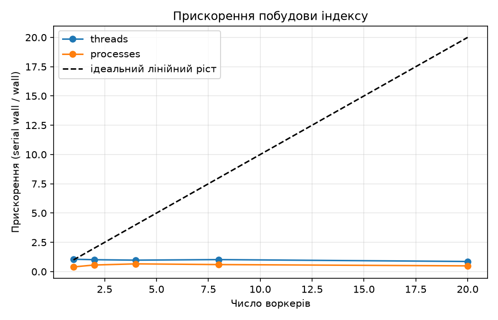

<!-- Встав у README.md. Усе в <кутових дужках> заміни своїми даними. -->

## Лаба 5: паралельна побудова індексу

```bash
findex index data_big --workers 4 --executor processes
```

### Машина

- Процесор: <модель> (дізнатись: `Get-CimInstance Win32_Processor | Select Name`)
- Ядер / логічних процесорів: <N> (`os.cpu_count()`)
- ОС: <Windows 11> · Python: <3.13.x> і <3.13.xt>
- Корпус: <N> документів, <M> МБ (`scripts/make_corpus.py data data_big --chars 50000 --copies <K>`)

### Методика

Кожна конфігурація запускається окремим процесом, 3 рази, у таблиці медіана
(`scripts/bench_index.py`). Wall = `perf_counter`; CPU = `process_time` головного процесу
плюс CPU воркерів-процесів; Peak RSS — пік пам'яті батьківського процесу;
Merge — час послідовного злиття. Прискорення = wall(serial) / wall(конфігурації).

### Результати

<встав вивід `python scripts/plot_speedup.py results.json results_313t.json`>



### Чому так (своїми словами, одна сторінка)

1. **Чому потоки не прискорили.** <GIL: що саме він блокує; що робили 8 потоків>
2. **Чому процеси прискорили і чим це оплачено.** <у кожного свій інтерпретатор і GIL; CPU > wall; більше RSS; pickle; старт spawn>
3. **Де видно закон Амдала.** <частка merge у serial-часі; стеля = 1 / (частка merge); порівняй з графіком>
4. **Що змінилось на Python 3.13t.** <`sys._is_gil_enabled()` = False; чи масштабуються потоки; ціна на одному потоці>
5. **Гонитва.** <`experiments/race_demo.py`: скільки оновлень втрачено без Lock; виправлення>
6. **(Бонус) ввід-вивід.** <потоки на читанні файлів/URL масштабуються, бо GIL відпускається під час очікування>
