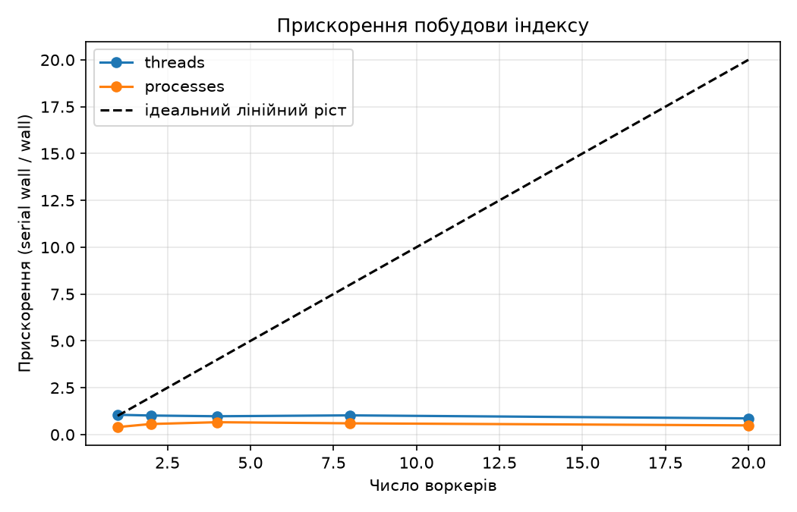

<!-- Встав у README.md. Усе в <кутових дужках> заміни своїми даними. -->

## Лаба 5: паралельна побудова індексу

```bash
findex index data_big --workers 4 --executor processes
```

### Машина

- Процесор: <модель> (дізнатись: `Get-CimInstance Win32_Processor | Select Name`)
- Ядер / логічних процесорів: <N> (`os.cpu_count()`)
- ОС: <Windows 11> · Python: <3.13.x> і <3.13.xt>
- Корпус: <N> документів, <M> МБ (`scripts/make_corpus.py data data_big --chars 50000 --copies <K>`)

### Методика

Кожна конфігурація запускається окремим процесом, 3 рази, у таблиці медіана
(`scripts/bench_index.py`). Wall = `perf_counter`; CPU = `process_time` головного процесу
плюс CPU воркерів-процесів; Peak RSS — пік пам'яті батьківського процесу;
Merge — час послідовного злиття. Прискорення = wall(serial) / wall(конфігурації).

### Результати

<встав вивід `python scripts/plot_speedup.py results.json results_313t.json`>



### Чому так (своїми словами, одна сторінка)

1. **Чому потоки не прискорили.** <GIL: що саме він блокує; що робили 8 потоків>
2. **Чому процеси прискорили і чим це оплачено.** <у кожного свій інтерпретатор і GIL; CPU > wall; більше RSS; pickle; старт spawn>
3. **Де видно закон Амдала.** <частка merge у serial-часі; стеля = 1 / (частка merge); порівняй з графіком>
4. **Що змінилось на Python 3.13t.** <`sys._is_gil_enabled()` = False; чи масштабуються потоки; ціна на одному потоці>
5. **Гонитва.** <`experiments/race_demo.py`: скільки оновлень втрачено без Lock; виправлення>
6. **(Бонус) ввід-вивід.** <потоки на читанні файлів/URL масштабуються, бо GIL відпускається під час очікування>
## Асинхронний веб-краулер (Lab 6)

### Дозвіл на обхід та етика краулера
* **Джерело даних:** локальний тестовий HTTP-сервер `scripts/mock_site.py` (`http://127.0.0.1:8765`), створений спеціально для тестування та бенчмарків у межах лабораторної роботи без навантаження на зовнішні сервери.
* **Ідентифікація (`User-Agent`):** `findex-crawler/0.6 (+https://github.com; contact=student@example.edu)`.
* **Дотримання обмежень:** краулер кешує `/robots.txt` окремо для кожного хоста (`RobotsCache`), підтримує прапорець `--max-pages` (жорстка стеля зібраних сторінок із негайним скасуванням воркерів), загальний семафор (`--concurrency`), семафор на хост (`--per-host`) та мінімальну паузу між запитами до одного домену (`--delay`).

### Результати бенчмарку (`scripts/bench_crawl.py`)

Заміри проведено на 200 сторінках (`http://127.0.0.1:PORT/page/0`, затримка відповіді сервера `0.04 с`):

| Concurrency | Wall, с | Сторінок/с | Помилки | Peak RSS, МБ |
| :---: | :---: | :---: | :---: | :---: |
| 1 | 14.17 | 14.1 | 2 | 41 |
| 5 | 4.46 | 43.9 | 2 | 44 |
| 20 | 2.49 | 74.6 | 2 | 45 |

### Відповіді та аналіз (Reflection)

1. **Чому 20 одночасних запитів в одному потоці (`2.49 с`) швидші за підхід лаби 5:**
   * Індексація в лабі 5 — це **CPU-bound** задача, яка впирається в обчислювальні ядра процесора та GIL.
   * Веб-краулінг — це **I/O-bound** задача: 95%+ часу корутина просто чекає відповіді мережі. Коли один запит робить `await client.get(...)`, він віддає керування циклу подій (`event loop`), і той самий потік миттєво обслуговує решту 19 запитів. Прискорення склало **5.69×** (`14.17 с` → `2.49 с`), а споживання пам'яті зросло лише на **4 МБ** (`41` → `45 МБ`), без створення важких процесів.
2. **Чого коштує ліміт на хост і навіщо він потрібен:**
   * Семафор на хост (`--per-host`) та мінімальна затримка (`--delay`) штучно обмежують максимальну пропускну здатність на одному домені (якщо стоїть `--delay 0.1`, швидкість на один домен фізично не перевищить ~10 стор./с навіть при `--concurrency 20`).
   * Проте це обов'язковий захист: без нього краулер перетворюється на DDoS-атаку, миттєво отримує блокування `429 Too Many Requests` або бан по IP, тоді як при обході різних доменів одночасно загальний семафор на 20 запитів продовжує працювати на повну швидкість.
3. **Де цикл подій зупинився б, якби індексація йшла всередині корутини:**
   * Якби `tokenize()` і побудова індексу запускалися прямо всередині `async def worker()` без окремого виконавця, вони б виконувалися синхронно в єдиному потоці `event loop`. Поки процесор токенізує текст однієї сторінки, жодна інша корутина не змогла б ні прийняти байти із сокета, ні вчасно обробити таймаути (`asyncio.timeout`), а `--debug-asyncio` зафіксував би попередження про повільний callback (`Executing <Task ...> took ... seconds`). Саме тому краулер пише у `.jsonl`, а індексація (`findex index`) винесена за межі циклу подій.

### Приклад обробленого збою з `crawl.log`

Під час обходу тестового сайту краулер зустрів тимчасові збої (`429 Too Many Requests` із заголовком `Retry-After: 0.15` та `503 Service Unavailable`), виконав повторні спроби з *exponential backoff + jitter* і успішно завантажив обидві сторінки, тоді як `404 Not Found` та заборонений у `robots.txt` шлях `/private/secret` не повторював:

```text
ERR	status=0	attempts=0	error=disallowed_by_robots	time=0.000s	http://127.0.0.1:8765/private/secret
OK	status=200	attempts=2	bytes=86	time=0.316s	http://127.0.0
ERR	status=404	attempts=1	error=HTTP 404	time=0.081s	http://127.0.0
OK	status=200	attempts=2	bytes=86	time=0.423s	http://127.0.0
```
> **Публічний вебсервіс (Lab 7):** https://onrender.com

## Вебсервіс пошуку на FastAPI (Lab 7)

### Навантажувальне тестування (`scripts/bench_web.py`)

| Конфігурація | Запитів/с (RPS) | p50, мс | p95, мс | p99, мс |
| :--- | :---: | :---: | :---: | :---: |
| 1 воркер (`async def`) | 10.8 | 1781.02 | 2499.76 | 3023.41 |
| 1 воркер (`def`) | 10.9 | 1800.32 | 3410.63 | 3598.35 |
| 4 воркери (`def`) | 20.3 | 966.99 | 1311.12 | 1405.22 |
| Розгорнутий сервіс (Render) | <RPS> | <p50> | <p95> | <p99> |

**Аналіз результатів (зв'язок із лабами 5–6):**
* **Де винен GIL (1 воркер `async def` vs 1 воркер `def`):** пошук і побудова сніпетів — це CPU-bound операції у чистому Python. На 1 воркері з `async def` цикл подій (`event loop`) повністю блокується на час обчислення кожного запиту, а на 1 воркері з `def` FastAPI виносить обробник у пул потоків (`anyio` threadpool) — тому `event loop` лишається вільним для прийому нових з'єднань, але через **GIL** у рамках одного процесу потоки все одно ділять одне ядро CPU (`10.8` проти `10.9 RPS`).
* **Де допомогли кілька процесів (4 воркери):** запуск 4 окремих процесів `uvicorn` (`--workers 4`) дає кожному воркеру власний інтерпретатор і власний GIL, що дозволяє паралельно навантажити кілька ядер процесора — пропускна здатність зросла майже вдвічі (**`20.3 RPS`**), а медіанна затримка `p50` зменшилася майже у 2 рази (**`966.99 мс`** проти `1800.32 мс`).

